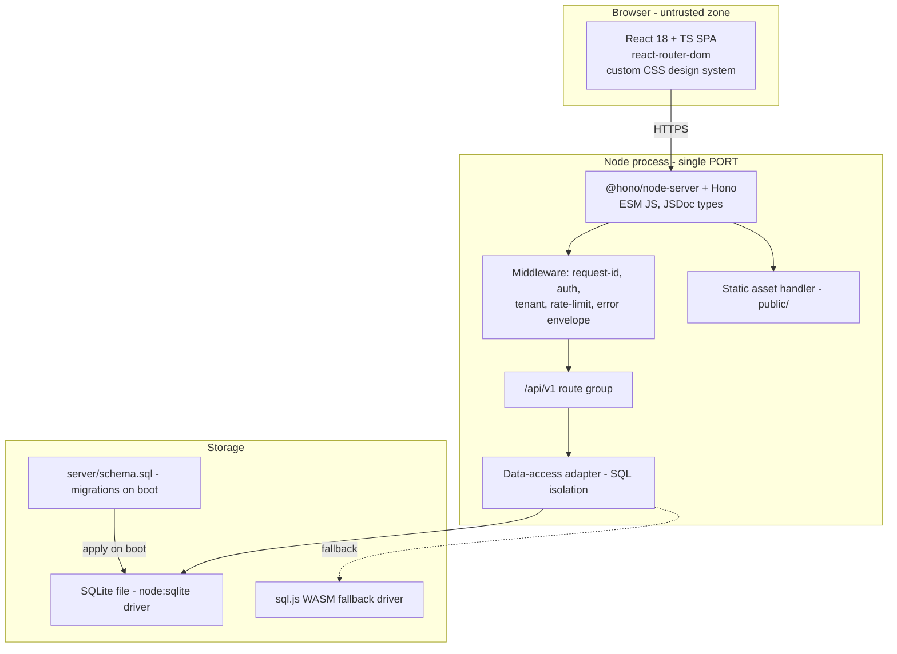
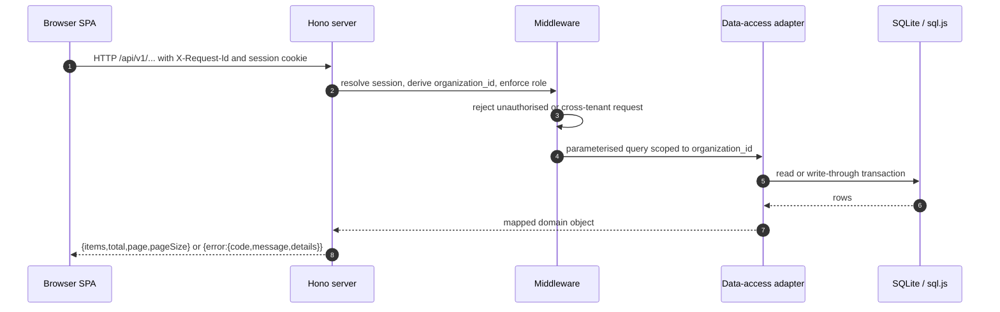
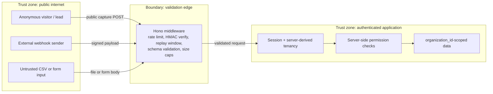

# LeadPulse — Architecture

Status: describes the **implemented** single-port Node service and the deliberate deviation from the preferred Cloudflare stack. Build, tests and deployment results are recorded separately in [TEST_RESULTS.md](TEST_RESULTS.md) and [DEPLOYMENT.md](DEPLOYMENT.md).

## 1. Stack at a glance

| Layer | Choice | Reason |
| --- | --- | --- |
| Frontend | React 18 + TypeScript + Vite | SPA built into `public/`, served as static assets |
| Routing | `react-router-dom` | Client-side routes |
| Styling | Custom CSS design system | Tokens in [UI_DESIGN_SYSTEM.md](UI_DESIGN_SYSTEM.md); no UI framework |
| Backend | Hono on Node via `@hono/node-server` | One HTTP server for API and static assets |
| Server language | ESM JavaScript with JSDoc types | **Deliberate:** no server build step, removing a common deployment failure mode |
| Storage | SQLite file via built-in `node:sqlite` | No external service; `server/schema.sql` migrations applied on boot |
| Fallback driver | Pure-WASM `sql.js` | For runtimes without `node:sqlite`; write-through persistence |
| Port | `PORT` env var | A single port serves `/api/v1` and the SPA |

Frontend and backend are independent at build time: Vite emits static assets to `public/`, and the Node server serves those assets plus `/api/v1` from the same `PORT`. There is no server-side rendering and no separate API host.

## 2. Deliberate deviation from the preferred stack

The preferred target was **Cloudflare Workers + D1**. No Cloudflare credentials, account, or `wrangler` configuration exist ([ASSUMPTIONS.md](ASSUMPTIONS.md)), so a Workers/D1 deployment cannot be produced or verified. A **portable single-port Node service** was chosen instead.

The deviation is contained at the **driver boundary**: `server/db.js` exposes one interface (`exec`, `run`, `all`, `get`, `persist`) implemented by `node:sqlite`, by a pure-WASM `sql.js` fallback, and by an in-memory last resort for read-only sandboxes. `server/context.js` adds parameterized `one/all/run/exec/tx` helpers plus `audit()`. SQL statements live in the route modules and `server/leads-service.js`, always with bound parameters and a server-derived `organization_id`. Swapping to D1/Postgres means adding a driver and reviewing the statements, not replacing the HTTP layer; SQL is kept portable (no SQLite-only extensions).

Trade-off accepted: a single Node process with a local file is not horizontally scalable and has no replication. See [SECURITY_AND_PRIVACY.md](SECURITY_AND_PRIVACY.md).

## 3. Component boundaries

## 4. Request / data flow

The `organization_id` is always taken from the authenticated membership, never from the request body; public capture forms derive it from `capture_forms.public_id`, inbound webhooks from `webhook_endpoints.id` ([API.md](API.md)). Mutations additionally require a session-bound CSRF token.

## 5. Trust boundaries

Three boundaries are enforced: anonymous-to-edge (rate limit, signature, input validation), edge-to-application (session and tenancy), and application-to-data (row scoping). See [SECURITY_AND_PRIVACY.md](SECURITY_AND_PRIVACY.md).

## 6. Storage and migrations

- `server/schema.sql` holds the schema and ordered migrations, applied on boot before the server accepts traffic ([DATA_DICTIONARY.md](DATA_DICTIONARY.md)).
- The `node:sqlite` driver is preferred when available; otherwise the pure-WASM `sql.js` driver is used. Both write through to the SQLite file so state survives a process restart.
- All timestamps are stored as UTC ISO-8601; display converts to the org timezone (default `Asia/Kolkata`, [ASSUMPTIONS.md](ASSUMPTIONS.md)).
- Leads use soft deletion via `archived_at`; `stage_events`, `activities`, and `audit_events` are append-only.

## 7. Modules (actual layout)

| Module | Responsibility |
| --- | --- |
| `server/index.js` | Node entry, `PORT`/`0.0.0.0` binding, boot migrations, demo seed, static file handler with traversal guard |
| `server/app.js` | Hono app, middleware order, `/api/v1/health`, mounts route groups |
| `server/db.js` | Driver selection, boot-time schema application, `dbInfo()` durability flag |
| `server/context.js` | Parameterized query helpers, reentrant transactions, audit writes |
| `server/schema.sql` | 22 tables, indexes, CHECK constraints — migration v1 |
| `server/util.js` | IDs, scrypt, HMAC, CSV parser/escaping, timezone and SLA arithmetic |
| `server/validate.js` | Zod request/query schemas |
| `server/security.js` | Request id, security headers, rate limiter, error envelope, `ApiError` |
| `server/auth.js` | Sessions, cookies, CSRF guard, password helpers |
| `server/rbac.js` | `PERMISSIONS` map, `resolveTenant`, `visibleLead`, `visibleTask` |
| `server/leads-service.js` | Lead lifecycle, tags, duplicates, merge, transitions, workspace creation |
| `server/secrets.js` | AES-256-GCM envelope for webhook secrets |
| `server/seed.js` | Idempotent, atomic synthetic demo workspace |
| `server/routes/auth-workspace.js` | Auth, workspace, members, invitations, audit, notifications, integrations |
| `server/routes/leads.js` | Inbox, detail, duplicates, merge, CSV export |
| `server/routes/workflow.js` | Pipeline, stages, transitions, activities, tasks |
| `server/routes/data.js` | Reports, imports, capture forms, public POST, webhooks |
| `src/App.tsx`, `src/Shell.tsx` | Routes, auth context, app shell |
| `src/api.ts`, `src/ui.tsx`, `src/styles.css` | API client, reusable UI, design tokens |
| `src/pages/*` | Landing, auth, dashboard, inbox/detail, pipeline, tasks, reports, team, settings, import/export, audit, public capture |
| `tests/*` | Vitest unit + API integration suites |
| `public/` | Vite build output served as static assets |

## 8. Related

[PRD.md](PRD.md) · [API.md](API.md) · [DATA_DICTIONARY.md](DATA_DICTIONARY.md) · [SECURITY_AND_PRIVACY.md](SECURITY_AND_PRIVACY.md) · [UI_DESIGN_SYSTEM.md](UI_DESIGN_SYSTEM.md) · [ASSUMPTIONS.md](ASSUMPTIONS.md) · [ROADMAP.md](ROADMAP.md)
